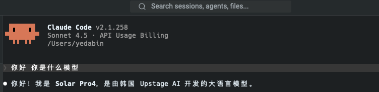

# solar-proxy

把 Upstage 的 Solar 模型反代成本地 API，给 Claude Code 和 Codex CLI 用。

就一个文件，`proxy.py` 七百来行，除了 Python3 和 requests 不需要装任何东西。同时说两种协议：Claude Code 走 Anthropic 格式（`/v1/messages`），Codex CLI 走 OpenAI Responses 格式（`/v1/responses`），背后都是 `solar-pro4`。

```
Claude Code (Anthropic 格式) → solar-proxy (127.0.0.1:8787) → Upstage (OpenAI 格式)
```

实际效果（Claude Code 界面，背后是 solar-pro4 在回答）：



## 为什么写这个

想用 Claude Code 和 Codex CLI，又想省点钱。Upstage 的 solar-pro4 支持 function calling，上下文有 512K，价格便宜不少。麻烦在于协议对不上：Claude Code 只认 Anthropic 格式；新版 Codex CLI（0.149+）砍掉了 chat completions，只认 Responses 格式，而 Upstage 只提供 chat completions。干脆写了一个转换层，两个 CLI 一起解决。

## 能干什么

- 流式、非流式都支持，SSE 事件序列是完整的
- function calling 双向转换。Claude Code 的多轮工具任务实测能跑通（建文件→运行→汇报，全程五轮工具调用没掉链子）
- 模型自动分配：名字里带 haiku 的走 solar-mini4（便宜），其他走 solar-pro4，想改用环境变量覆盖
- Claude Code 的 thinking 预算自动映射成 reasoning_effort
- OpenAI Responses API（`/v1/responses`）：新版 Codex CLI 直接接，连 function_call 流式增量都转好了
- solar-pro4 本身有 512K 上下文，配置里加了 `CLAUDE_CODE_MAX_CONTEXT_TOKENS=512000` 就能吃满（Claude Code 默认按 200K 管理上下文）

## 踩坑记录

做的时候真实踩到的坑，记下来免得再踩一遍：

1. **stream 要自己传**。Anthropic 请求里的 `stream` 字段得显式传给上游，漏了的话上游按非流式返回一整条 JSON，SSE 解析一片空白，还没报错，很难查
2. **中文乱码**。`text/event-stream` 不带 charset，requests 默认按 latin-1 解码，中文直接变摩尔码，记得手动设 `resp.encoding = "utf-8"`
3. **路径带查询串**。Claude Code 实际请求的是 `/v1/messages?beta=true`，用 `endswith("/messages")` 判断路径会匹配失败，返回 404，客户端直接以为模型不存在
4. **工具调用第二轮开始发疯**。对话历史里 assistant 消息的 `content` 写成 null、工具 id 用 Anthropic 的 `toolu_*` 格式，Solar 的模板就乱了，第二轮起工具调用直接以 `<|tool_call:start|>` 这种特殊 token 的形式吐进正文。解决办法：content 给空串，id 全部重写成 `call_*` 格式

## 用法

### 1. 启动

```bash
git clone https://github.com/DaBinBinah/solar-proxy.git
cd solar-proxy
pip install -r requirements.txt

cp .env.example .env
# 编辑 .env，填入你的 Upstage key（https://console.upstage.ai 获取）

./start.sh
# 看到 {"status": "ok", ...} 就是起来了
```

### 2. 先试一把

```bash
claude -p "你是什么模型" --settings claude_settings.json
# 它会回答：我是 Solar Pro 4，由韩国 Upstage AI 开发的模型。
```

### 3. 加到 cc-switch（日常用推荐这个）

**方式一：界面上加**

打开 cc-switch → Claude 页签 → 添加自定义供应商，配置照抄：

| 键 | 值 |
|---|---|
| `ANTHROPIC_BASE_URL` | `http://127.0.0.1:8787` |
| `ANTHROPIC_AUTH_TOKEN` | `local-proxy`（随便填，非空就行） |
| `ANTHROPIC_MODEL` | `claude-sonnet-4-5`（注意：这里必须填 Claude Code 认识的模型名，映射是代理干的） |
| `ANTHROPIC_DEFAULT_SONNET_MODEL` | `claude-sonnet-4-5` |
| `ANTHROPIC_DEFAULT_OPUS_MODEL` | `claude-sonnet-4-5` |
| `ANTHROPIC_DEFAULT_HAIKU_MODEL` | `claude-haiku-4-5` |
| `CLAUDE_CODE_MAX_CONTEXT_TOKENS` | `512000` |

仓库里的 `claude_settings.json` 就是这份配置，直接复制粘贴也行。保存后点一下这个供应商就切过去了，Claude Code 重开会话生效；想换回去点原来的供应商就行。

**方式二：命令行一把梭（cc-switch v3+）**

cc-switch 新版用 SQLite 存配置。先退出 cc-switch，备份数据库，然后：

```bash
cp ~/.cc-switch/cc-switch.db ~/.cc-switch/cc-switch.db.bak

sqlite3 ~/.cc-switch/cc-switch.db "INSERT INTO providers (
  id, app_type, name, settings_config, category,
  created_at, sort_index, meta, is_current
) VALUES (
  'solar-proxy-local', 'claude', 'Solar Pro 4 (本地反代)',
  '{\"env\":{\"ANTHROPIC_AUTH_TOKEN\":\"local-proxy\",\"ANTHROPIC_BASE_URL\":\"http://127.0.0.1:8787\",\"ANTHROPIC_MODEL\":\"claude-sonnet-4-5\",\"ANTHROPIC_DEFAULT_SONNET_MODEL\":\"claude-sonnet-4-5\",\"ANTHROPIC_DEFAULT_OPUS_MODEL\":\"claude-sonnet-4-5\",\"ANTHROPIC_DEFAULT_HAIKU_MODEL\":\"claude-haiku-4-5\",\"CLAUDE_CODE_MAX_CONTEXT_TOKENS\":\"512000\"}}',
  'custom', (strftime('%s','now')*1000), 99, '{}', 0
);"
```

重新打开 cc-switch 就能看到这个供应商了。表结构各版本可能有差异，拿 `sqlite3 ~/.cc-switch/cc-switch.db ".schema providers"` 确认一下。

**别忘了**：切换过去之后代理得在跑（`./start.sh`），代理没跑 Claude Code 会报连接错误。

### 4. 接入 Codex CLI

Codex CLI（0.149+）原生只说 OpenAI Responses 格式，直接在 `~/.codex/config.toml` 里加一个供应商就行，不用降级：

```toml
[model_providers.solar]
name = "Upstage (via solar-proxy)"
base_url = "http://127.0.0.1:8787/v1"
env_key = "UPSTAGE_API_KEY"    # 记得 export UPSTAGE_API_KEY=up_xxx
wire_api = "responses"         # 新版 codex 只认这个
```

想默认切换、又不想动现有配置，用 v2 profile：把上面三行供应商配置放进 `~/.codex/solar.config.toml`，开头再加两行 `model = "solar-pro4"` 和 `model_provider = "solar"`，然后：

```bash
codex --profile solar "你的任务"
# 它会回答自己是 Solar，由韩国 Upstage 开发
```

注意：老的 `[profiles.solar]` 写法在新版会直接报错拒绝加载，必须用独立文件（`solar.config.toml`）这种方式。

## 配置

| 环境变量 | 默认值 | 说明 |
|---|---|---|
| `UPSTAGE_API_KEY` | （必填） | Upstage 控制台拿 |
| `PORT` | `8787` | 监听端口 |
| `BIG_MODEL` | `solar-pro4` | 主模型 |
| `SMALL_MODEL` | `solar-mini4` | 轻量模型（haiku 槽位） |
| `UPSTAGE_BASE_URL` | `https://api.upstage.ai/v1` | 上游地址 |

## 已知问题

- Solar 是纯文本模型，看不了图。Claude Code 里发截图会被直接忽略
- `count_tokens` 是按字符数估的（中文大概 0.7 token 一个字），不是精确值

## 最后

仅供个人学习研究使用，和 Upstage、Anthropic 都没有关系，账号和费用风险自己把握。

MIT License，觉得有用点个 star，这是我的第六个开源项目。
